# Projet Drone DJI F450 : analyse, instrumentation et vol autonome

> Projet intégrateur de l'**année académique 2023-2024**  
> **UCAC-ICAM** · Bachelor *General Engineering, Innovation & Technology* · Groupe III

Pendant un an, nous avons démonté, analysé, instrumenté et programmé un quadricoptère **DJI F450** piloté par un contrôleur de vol **Pixhawk**. Le travail était organisé par domaines d'ingénierie, chacun encadré par un référent expert. Ce dépôt présente surtout deux domaines :

- **EEE (électronique / électrotechnique)** : blocs fonctionnels, chaînes d'information et d'énergie, intégration d'une caméra, calibration des capteurs et des ESC, calcul de l'autonomie ;
- **MIA (informatique)** : programmation Python avec DroneKit, simulation SITL, mission multi-points « goto » et mode **« Follow me »** piloté depuis un smartphone.

<p align="center">
  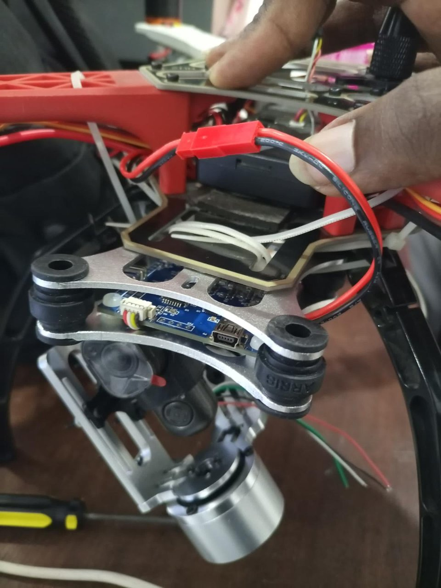
  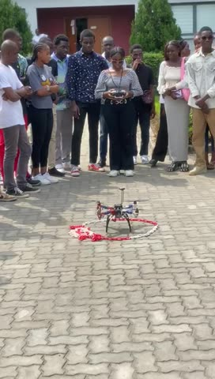
</p>

---

## Sommaire

1. [Objectifs](#-objectifs)
2. [Équipe](#-équipe)
3. [Matériel](#-matériel)
4. [Domaine EEE : électronique](#-domaine-eee--électronique)
5. [Domaine MIA : informatique et vol autonome](#-domaine-mia--informatique-et-vol-autonome)
6. [Autres domaines (MEO, MEC, EEM)](#-autres-domaines-meo-mec-eem)
7. [Tests de vol](#-tests-de-vol)
8. [Installation et exécution du code](#-installation-et-exécution-du-code)
9. [Organisation du dépôt](#-organisation-du-dépôt)
10. [Bilan et pistes d'amélioration](#-bilan-et-pistes-damélioration)

---

##  Objectifs

| Semestre | Objectif | Livrables principaux |
|---|---|---|
| **S1 : analyse du système** | Comprendre le drone domaine par domaine | Démontage et remontage, analyse fonctionnelle, schéma des blocs avec interfaces, chaînes d'information et d'énergie, diagramme de Sankey, programme **goto** en simulation |
| **S2 : amélioration du système** | Ajouter des fonctionnalités en mode projet | Caméra et nacelle, calibration capteurs/radio/ESC, calcul de l'autonomie, mode **Follow me** avec application mobile, optimisation du bras (CAO) |

**Besoin (bête à cornes) :** le drone rend service à l'utilisateur en agissant sur l'air, pour permettre le **déplacement aérien et la prise de vue**.

## Équipe

| Membre | Rôle |
|---|---|
| **NZABA Aubain** | Animateur du projet · Responsable **MIA** |
| **ABO William Junior** | Responsable **EEE** |
| NJOUGUEP Emmanuelle | Secrétaire · Responsable MEO |
| MAFOUA Prince, MFOUTIKA Cruz | Responsables MEC |
| BANGOU Thed, KABOU Marc | Responsables EEM |

Encadrement : les référents experts de chaque domaine de l'UCAC-ICAM.

## Matériel

| Élément | Référence / caractéristiques |
|---|---|
| Châssis | DJI Flame Wheel **F450** (bras polyamide, plaques PCB) |
| Contrôleur de vol | **Pixhawk 2.4.8** (ArduCopter) |
| Moteurs | 4 × brushless **920 KV** |
| Variateurs | 4 × **ESC 30 A** |
| Batterie | LiPo **3S 11,1 V**, 4400 mAh (6000 mAh également testée) |
| Hélices | Fibre de carbone |
| Localisation | Module **GPS + magnétomètre** |
| Radiocommande | **RadioLink AT9S Pro** + récepteur **R9DS** |
| Caméra | **RunCam Thumb Pro** (4K, IMX577) sur nacelle 2 axes |
| Logiciels | Mission Planner, Python 3.8, DroneKit, SITL, MIT App Inventor |

<details>
<summary>Photos du démontage</summary>

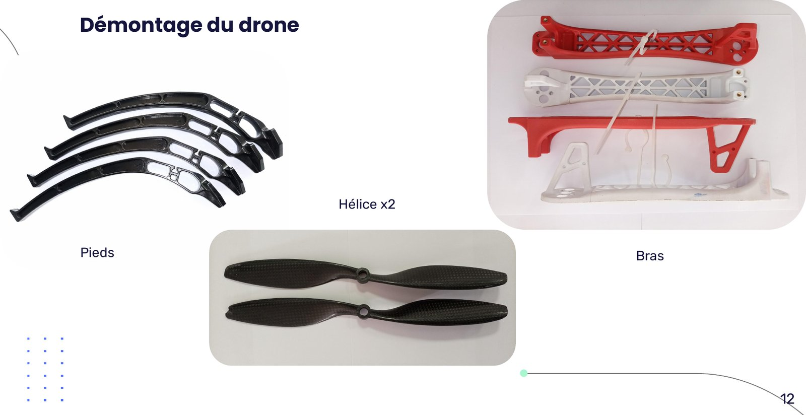
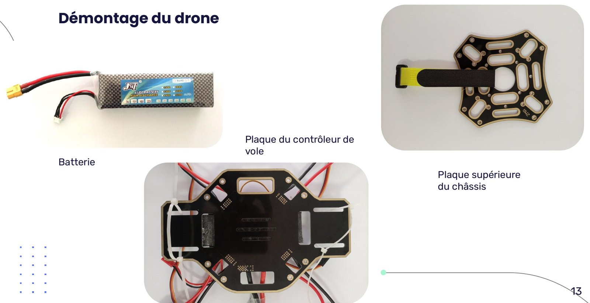
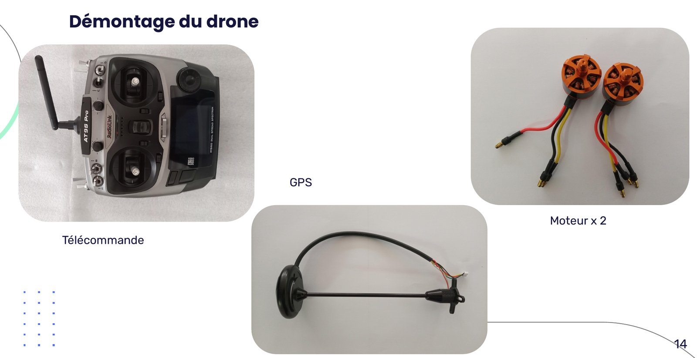
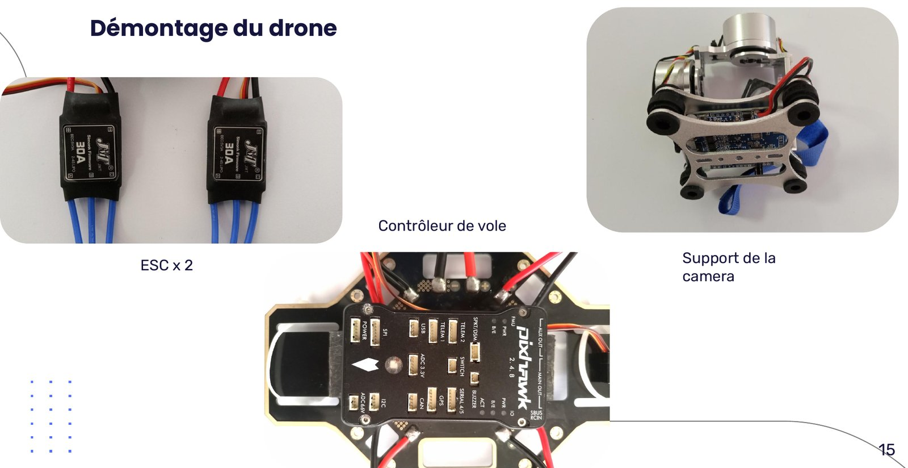

</details>

---

## Domaine EEE : électronique

*Responsable : ABO William Junior et Assistant MIA(Informatique)*

### 1. Décomposition en blocs fonctionnels (S1)

Les composants électroniques du drone et leur rôle :

| Composant | Rôle |
|---|---|
| **Contrôleur de vol** (Pixhawk) | Traite les commandes du pilote et les mesures des capteurs, stabilise le drone |
| **ESC** | Règle la vitesse de chaque moteur selon les ordres du contrôleur |
| **Moteurs brushless** | Moteurs synchrones sans balais : produisent la puissance mécanique |
| **Batterie LiPo 3S** | Alimente tout le système en énergie électrique |
| **Hélices** | Transforment la rotation en poussée |
| **Récepteur radio** (R9DS) | Reçoit les signaux de la télécommande et les transmet au contrôleur |
| **Télécommande** (AT9S Pro) | Permet au pilote de commander le drone par radio (2,4 GHz) |

| Schéma fonctionnel | Schéma électrique du quadricoptère |
|---|---|
| 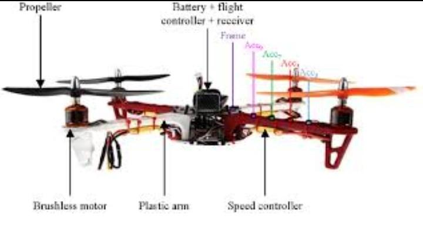 | 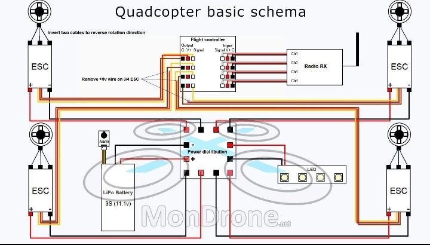 |

### 2. Chaîne d'information

Les capteurs envoient leurs mesures au **contrôleur de vol** :

| Grandeur mesurée | Capteur | Emplacement sur le F450 |
|---|---|---|
| Inclinaison (roulis, tangage, lacet) | Gyroscope | Carte du contrôleur de vol |
| Vitesse / accélération | Accéléromètre | Carte du contrôleur de vol |
| Altitude | Baromètre | Carte du contrôleur de vol |
| Cap (direction) | Magnétomètre | Module GPS, éloigné des perturbations |
| Latitude / longitude | GPS | Antenne sur le dessus du drone |
| Obstacles | Caméra / capteurs de distance | Bas du châssis |

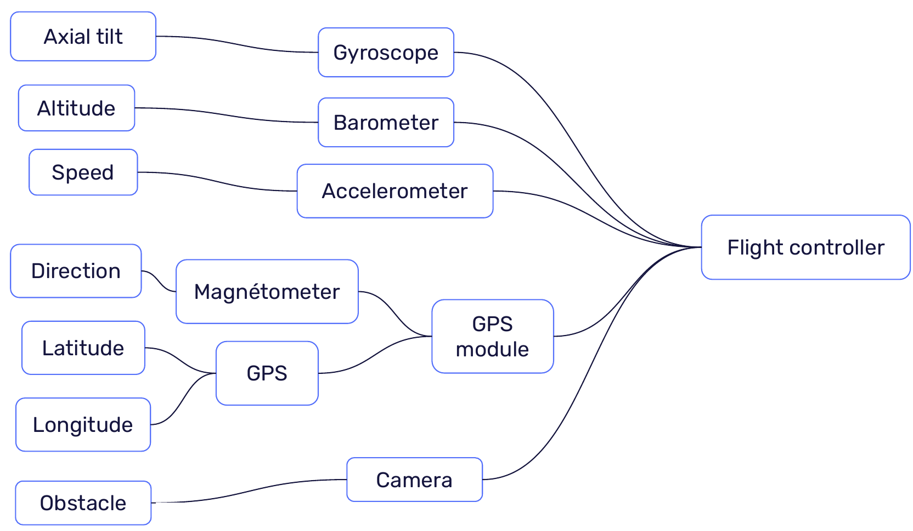

### 3. Chaîne d'énergie

**Alimenter → Distribuer → Convertir → Transmettre** : énergie chimique (batterie) → électrique (carte de distribution + ESC) → mécanique (moteurs) → poussée (hélices).

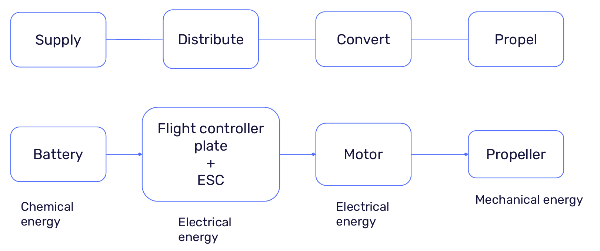

### 4. Chaîne synthétique information-énergie

Synthèse des deux chaînes : les capteurs **acquièrent**, la carte de contrôle **traite**, l'interface radio **communique**, et l'ordre obtenu commande le **variateur** (ESC), qui pilote les moteurs puis les hélices.

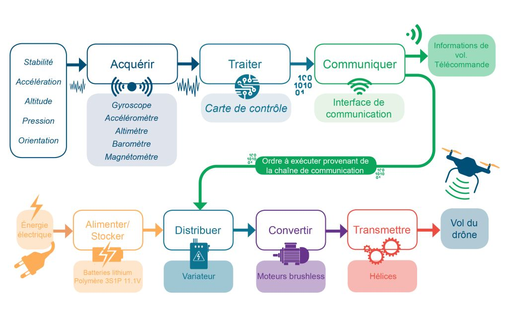

### 5. Bilan énergétique : diagramme de Sankey

Batterie 48,84 Wh (175 824 J). Rendements : batterie 97 %, ESC 83 %, moteurs 95,5 %.

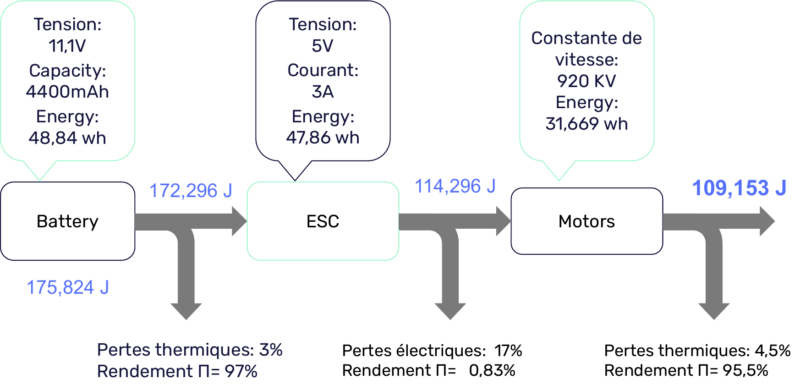

### 6. Caméra et nacelle (S2)

Intégration d'une **RunCam Thumb Pro** (4K, 155°, 16 g, 5 V / 500 mA) sur une **nacelle 2 axes**. Ce modèle a été retenu après comparaison avec une nacelle motorisée et une nacelle 3 axes (stabilisation, masse, coût). Le raccordement à la nacelle demande une soudure.

| | | |
|---|---|---|
| 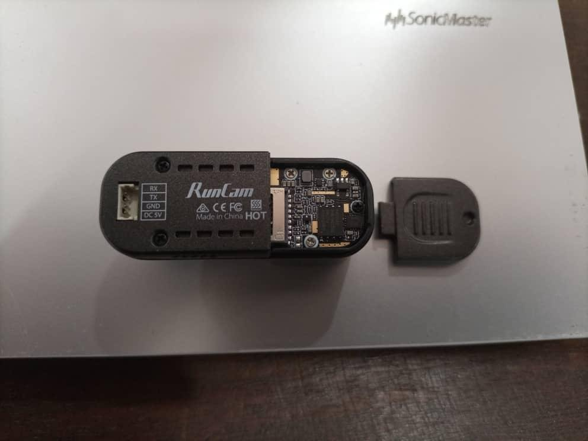 | 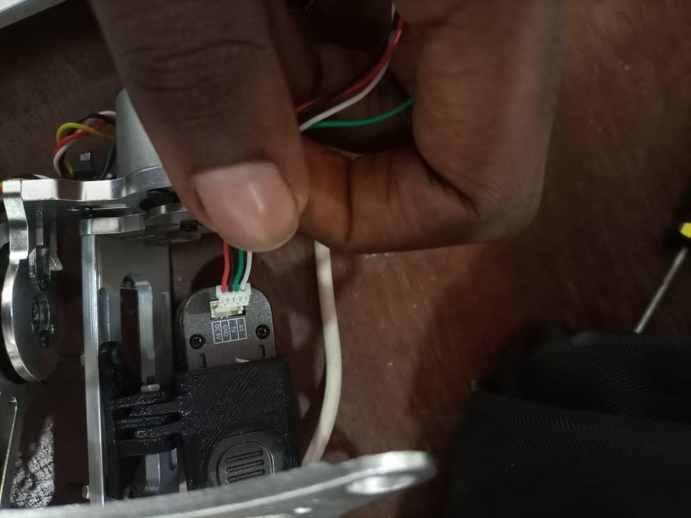 | 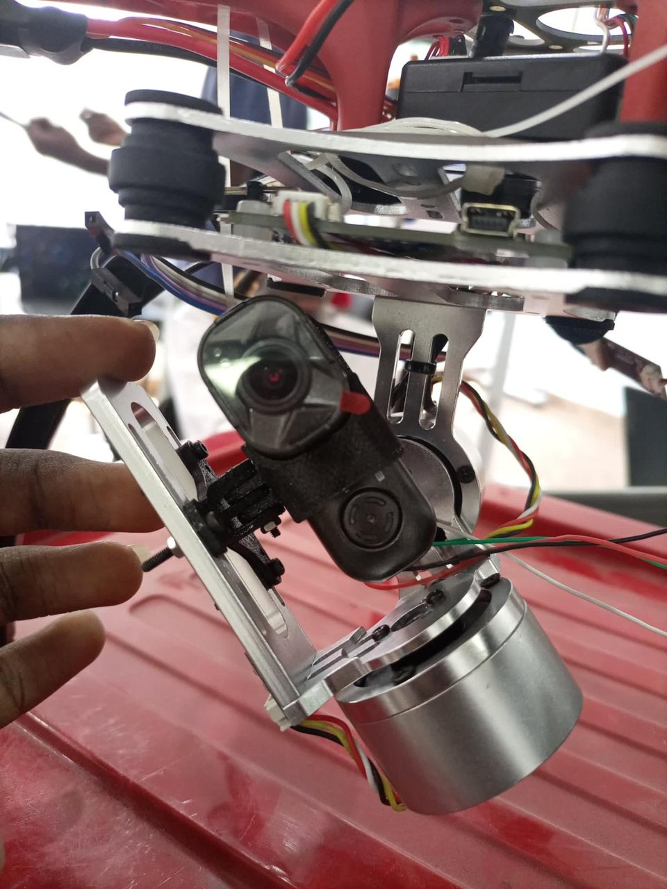 |

- Détails : [docs/eee/camera-nacelle.md](docs/eee/camera-nacelle.md)

### 7. Calibrations avec Mission Planner (S2)

**Compas**, **accéléromètre**, **radiocommande** (appairage AT9S Pro ↔ R9DS) et **ESC** (méthode retenue : ESC par ESC).

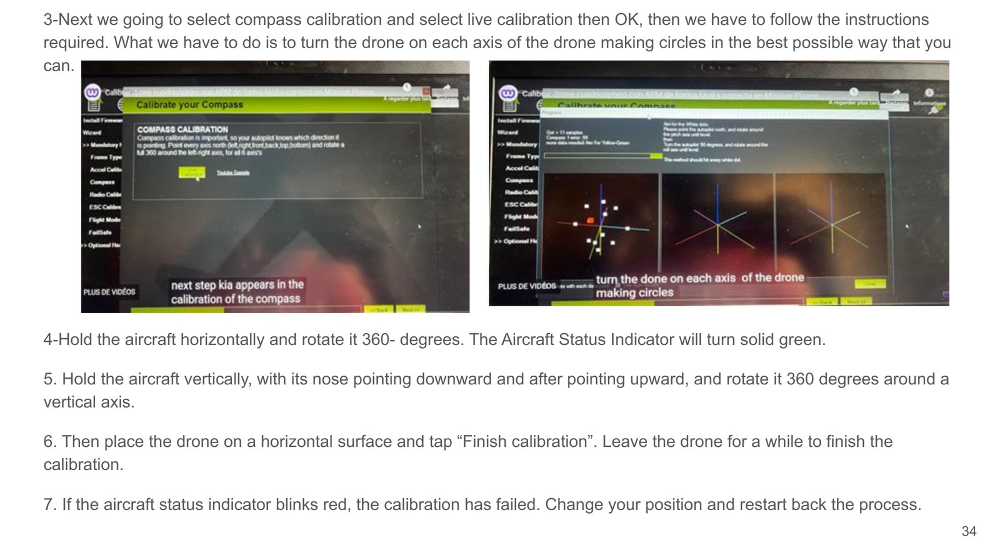

- Procédures détaillées, étape par étape : [docs/eee/calibration.md](docs/eee/calibration.md)

### 8. Autonomie (S2)

| | Courant | Autonomie |
|---|---|---|
| Estimation théorique (6000 mAh, 4 × 34,5 W = 138 W) | 6 A | ≈ 1 h |
| **Mesure en vol**, batterie 6000 mAh | 22,1 A sous 12,5 V (≈ 276 W) | **≈ 16 min** |
| **Mesure en vol**, batterie 4400 mAh | 22,1 A | **≈ 12 min** |

- Calculs : [docs/eee/autonomie-energie.md](docs/eee/autonomie-energie.md)

---

## Domaine MIA : informatique et vol autonome

*Responsable : NZABA Aubain assister par Moi(Abo william)*

Objectif du domaine : **faire voler le drone de façon autonome, sans télécommande**, avec des scripts Python qui envoient des ordres MAVLink au contrôleur de vol via [DroneKit](https://github.com/dronekit/dronekit-python). Les scripts ont été mis au point sur un drone virtuel (**SITL ArduCopter**), suivi en direct dans **Mission Planner**.

### 1. Mission « goto » multi-points (S1) : [`code/mia/goto_with_list.py`](code/mia/goto_with_list.py)

Le programme :

1. demande un point de départ, sous forme d'**adresse** (géocodée avec OpenStreetMap) ou de **coordonnées GPS** ;
2. crée un drone virtuel à cet endroit ;
3. demande la liste des lieux à visiter, en affichant la distance de chacun au point de départ (`geopy`) et une vitesse par lieu (1 à 15 m/s) ;
4. arme le drone, le fait décoller à 10 m puis visite chaque point à 20 m d'altitude ;
5. revient au point de départ (**RTL**) et atterrit.

```text
Choose an option: 1 = adresses, 2 = coordonnées GPS
→ adresse de départ → confirmation (Y/n)
→ "How many places do you want to visite ?"  → n adresses + vitesse
→ arm_and_takeoff(10) → simple_goto(point_i) … → RTL → atterrissage
```

| Simulation dans Mission Planner | Exécution |
|---|---|
| 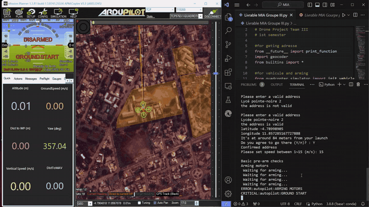 | 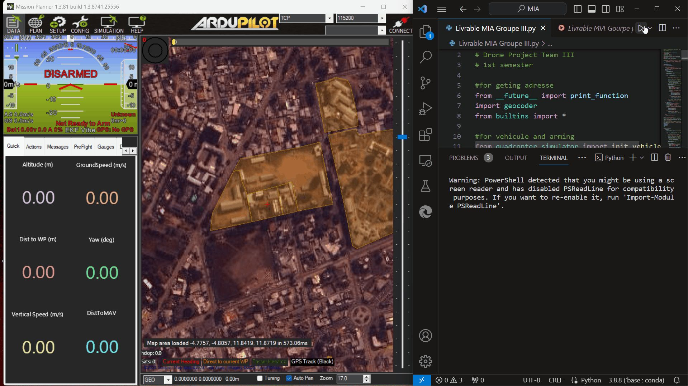 |

- Vidéo de démonstration : [media/videos/demo-goto-with-list.mp4](media/videos/demo-goto-with-list.mp4)

### 2. Mode « Follow me » (S2) : [`code/mia/follow_me.py`](code/mia/follow_me.py)

Le drone suit le smartphone de l'utilisateur.

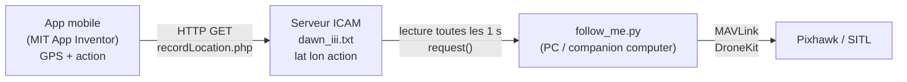

- **Application mobile** : envoie la position du téléphone à chaque déplacement, avec les boutons **Go**, **RLT** et **Pause**. Voir [code/mia/app-inventor](code/mia/app-inventor/README.md).
- **`request()`** : télécharge le fichier `lat lon action` et n'enregistre une nouvelle cible que si la position change et que l'action vaut `go`.
- **Boucle principale** : `simple_goto` vers la cible à 1 m/s, distance recalculée à chaque seconde (`check_distance()`), cible atteinte à moins de 0,2 m. L'action `rlt` déclenche le retour au point de départ, puis la fermeture du véhicule.

| Application | Logique App Inventor | Simulation |
|---|---|---|
| 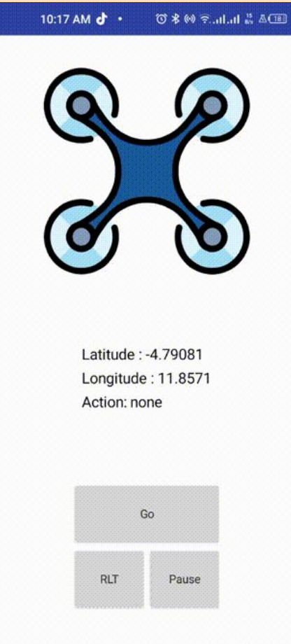 | 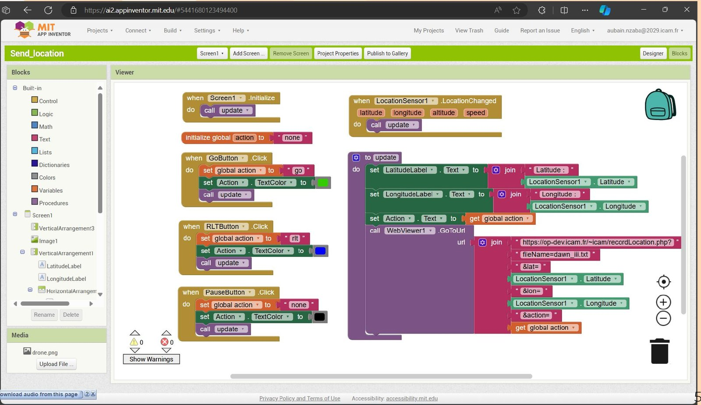 | 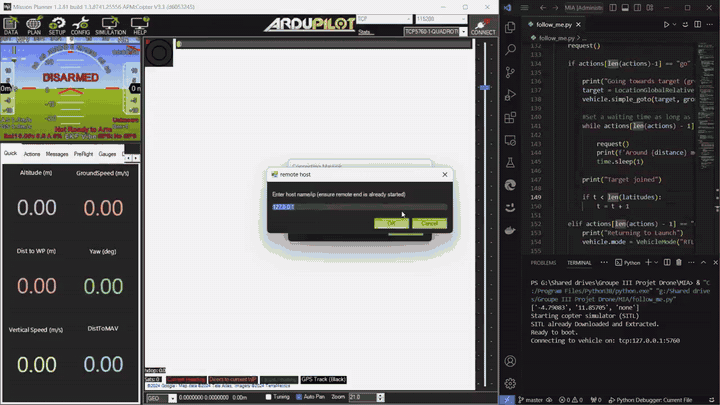 |

- Vidéo : [media/videos/demo-follow-me-simulation.mp4](media/videos/demo-follow-me-simulation.mp4)

### 3. Fichiers fournis par l'ICAM (kit de démarrage)

| Fichier | Rôle |
|---|---|
| [`quadcopter_simulator.py`](code/mia/quadcopter_simulator.py) | `init_vehicle(lat, lng)` : démarre un SITL aux coordonnées données et s'y connecte |
| [`exemples-icam/hello_drone.py`](code/mia/exemples-icam/hello_drone.py) | Premier contact : lit l'état du drone (GPS, batterie, mode…) |
| [`exemples-icam/geocodage_adresse.py`](code/mia/exemples-icam/geocodage_adresse.py) | Conversion d'une adresse en coordonnées (OpenStreetMap) |
| [`exemples-icam/simple_goto.py`](code/mia/exemples-icam/simple_goto.py) | Exemple DroneKit « simple goto » (© 3D Robotics), adapté pour nos tests |

---

## Autres domaines (MEO, MEC, EEM)

<details>
<summary><b>MEO</b> : gestion de projet (cahier des charges, planning, coûts)</summary>

Contraintes : temps, qualité du matériel, documentation. Jalons : conception → réalisation → revue jury S1 → tests de vol → déploiement (prise d'images) → lancement final S2.

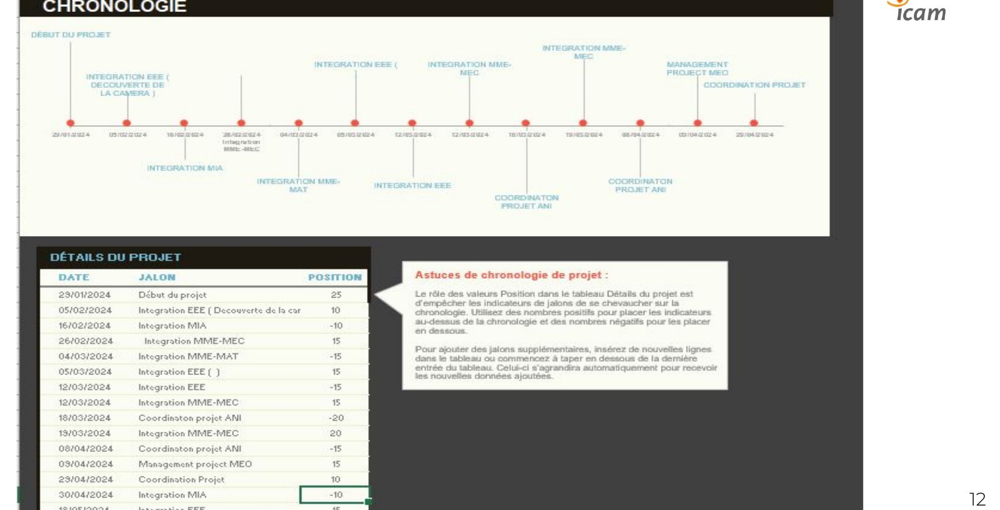
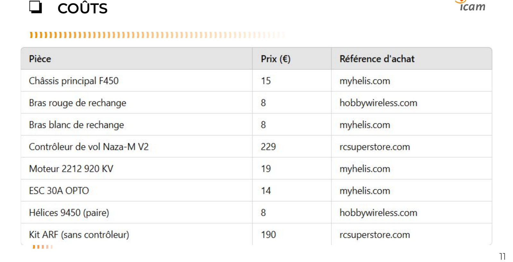
</details>

<details>
<summary><b>MEC</b> : analyse fonctionnelle et optimisation du bras</summary>

| Bête à cornes | Diagramme pieuvre |
|---|---|
| 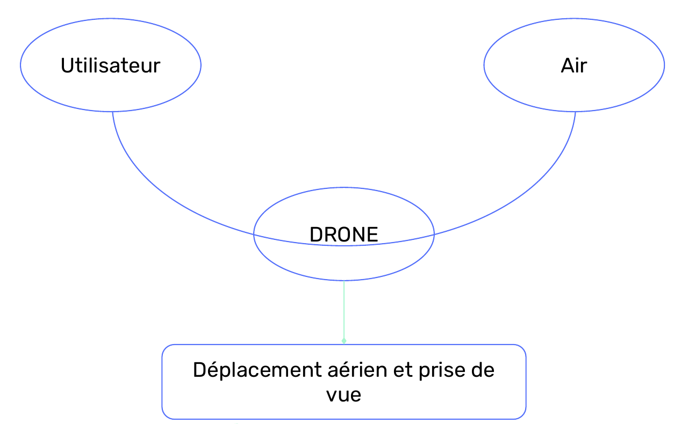 | 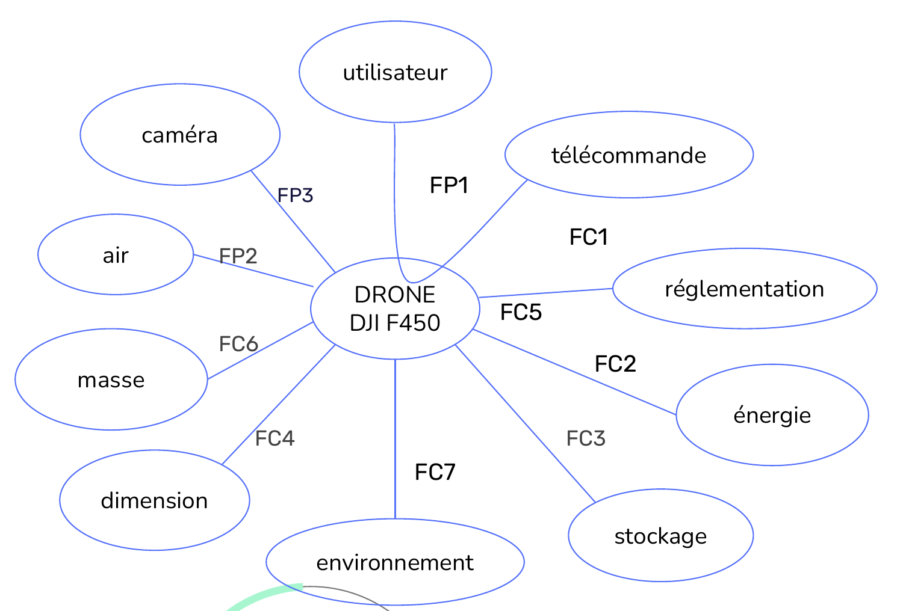 |

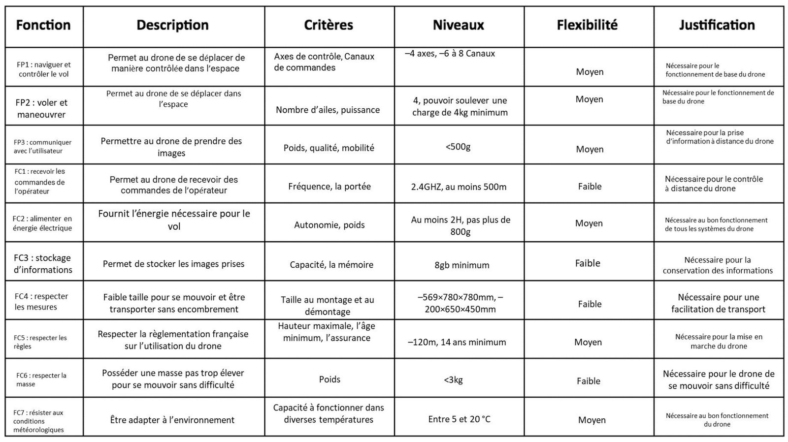
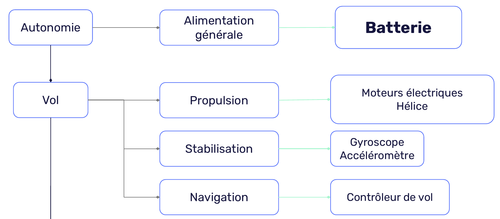
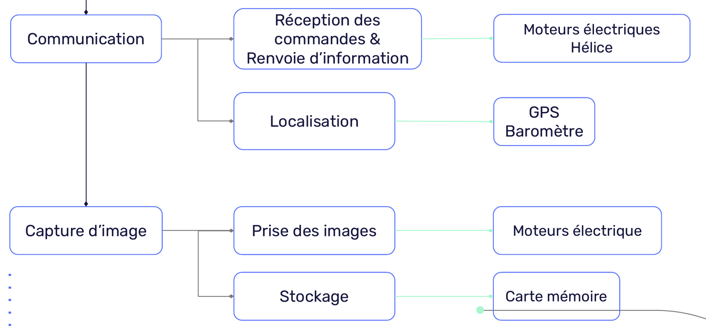

Optimisation du bras (bras creux, ovale ou rectangulaire, comparés par matrice de décision) et modélisation sous SolidWorks :

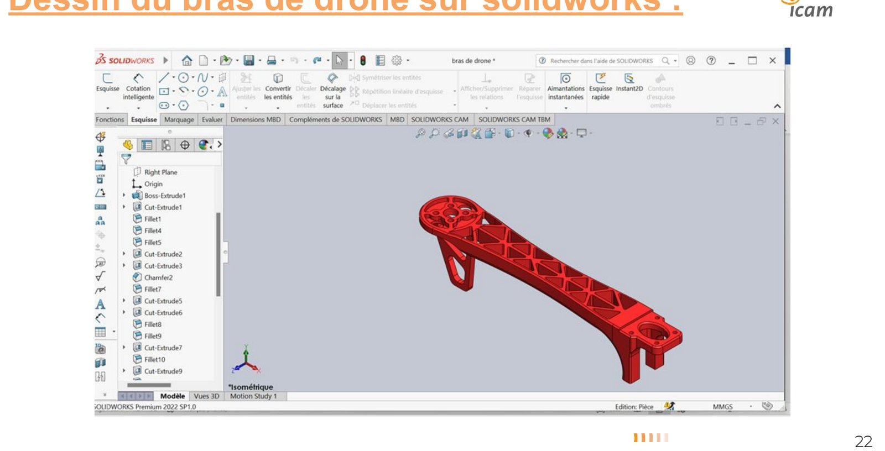
</details>

<details>
<summary><b>EEM</b> : matériaux et principes de vol</summary>

Choix des matériaux : hélices et châssis en fibre de carbone, bras en polyamide, pieds en PEhd, batterie lithium-polymère, vis en acier inoxydable. Étude des forces (poids, poussée, portance, traînée) pendant chaque phase de vol. Voir les supports de soutenance dans [docs/rapports](docs/rapports).
</details>

---

## Tests de vol

| | | |
|---|---|---|
| [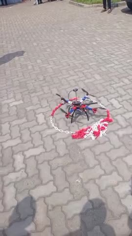](media/videos/test-vol-1.mp4) | [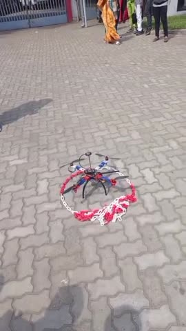](media/videos/test-vol-2.mp4) | [](media/videos/test-vol-4.mp4) |
| [test-vol-1.mp4](media/videos/test-vol-1.mp4) | [test-vol-2.mp4](media/videos/test-vol-2.mp4) | [test-vol-4.mp4](media/videos/test-vol-4.mp4) |

Autre vidéo : [test-vol-3.mp4](media/videos/test-vol-3.mp4)

---

## Installation et exécution du code

> DroneKit n'est pas compatible avec Python ≥ 3.10. Utiliser **Python 3.8 ou 3.9** (nous avons travaillé avec Python 3.8 sous conda).

```bash
conda create -n drone python=3.8 -y
conda activate drone
pip install -r requirements.txt
```

**Simulation « goto » :**
```bash
cd code/mia
python goto_with_list.py
```

**Visualiser dans Mission Planner :** *Connect → TCP*, hôte `127.0.0.1`, port `5763`.

**Follow me :**
```bash
cd code/mia
python follow_me.py                      # simulation SITL automatique
python follow_me.py --connect /dev/ttyACM0   # vrai drone (exemple de connexion série)
```

> `follow_me.py` lit les coordonnées sur un serveur de l'ICAM (`URL` dans la fonction `request()`). Pour le réutiliser, il faut pointer vers un serveur accessible qui expose `recordLocation.php` et le fichier `.txt` correspondant.
>
> Les scripts de `exemples-icam/` importent `quadcopter_simulator`. Il faut donc les lancer depuis `code/mia` (`python exemples-icam/hello_drone.py`) ou copier `quadcopter_simulator.py` à côté d'eux.

---

## Organisation du dépôt

```
projet-drone-dji-f450/
├── README.md
├── requirements.txt
├── code/
│   └── mia/
│       ├── goto_with_list.py        # mission multi-points (S1)
│       ├── follow_me.py             # mode Follow me (S2)
│       ├── quadcopter_simulator.py  # utilitaire SITL (ICAM)
│       ├── exemples-icam/           # exemples de départ
│       └── app-inventor/            # application mobile Follow me
├── docs/
│   ├── eee/
│   │   ├── calibration.md
│   │   ├── camera-nacelle.md
│   │   └── autonomie-energie.md
│   └── rapports/                    # livrables et soutenances (PDF)
└── media/
    ├── images/  (eee/, mia/, analyse/, demontage/)
    ├── photos/
    └── videos/
```

**Rapports et supports :**
- [Soutenance semestre 1](docs/rapports/soutenance-semestre-1.pdf) · [Soutenance semestre 2](docs/rapports/soutenance-semestre-2.pdf)
- [Livrable EEE, semestre 1](docs/rapports/EEE_livrable-semestre-1.pdf) · [Rapport EEE, semestre 2](docs/rapports/EEE_rapport-semestre-2.pdf) · [Montage caméra](docs/rapports/EEE_montage-camera.pdf)

---

## Bilan et pistes d'amélioration

**Acquis :** analyse complète d'un système pluritechnique ; maîtrise de la chaîne capteurs → contrôleur → ESC → moteurs ; calibration d'un Pixhawk ; mesure réelle de l'autonomie ; programmation de missions autonomes et communication smartphone → serveur → drone.

**Pour aller plus loin :**
- **EEE :** commander l'obturateur de la caméra depuis le Pixhawk (UART), transmettre la vidéo en direct (FPV), ajouter un capteur de courant pour suivre l'autonomie en vol.
- **MIA :** dans `goto_with_list.py`, la condition d'attente utilise `and` (la boucle s'arrête dès que la latitude *ou* la longitude est atteinte) : un test sur la distance (`geodesic(...) > seuil`) serait plus fiable. Il faudrait aussi rendre l'URL du serveur configurable (`--server`), gérer l'action `Pause` côté drone, embarquer le script sur un Raspberry Pi (*companion computer*) et passer à Python 3 récent avec `pymavlink` ou MAVSDK.
- **Suite du parcours :** ce travail sert de base au **projet Bateau autopiloté** (2024-2026).

---

<p align="center"><i>UCAC-ICAM · Bachelor General Engineering, Innovation & Technology · Projet Drone Groupe III · 2023-2024</i></p>
