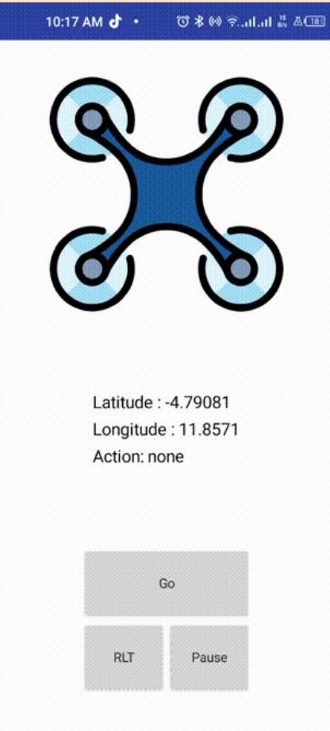
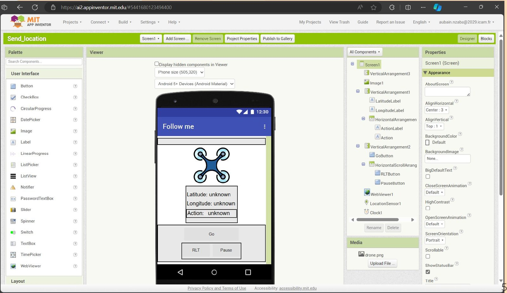
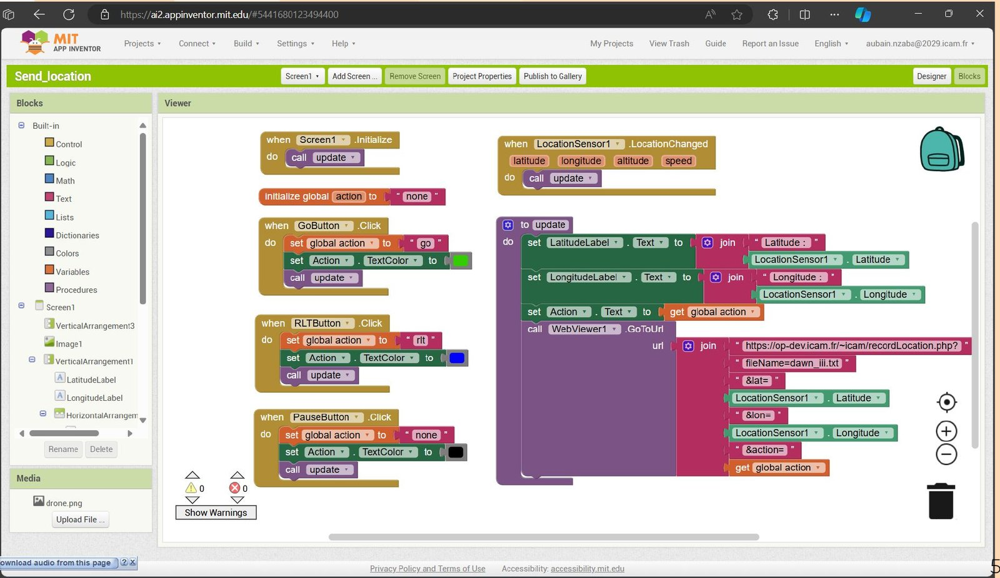

# Application mobile « Follow me » (MIT App Inventor)

Application Android/iOS réalisée avec [MIT App Inventor](https://appinventor.mit.edu/) (projet `Send_location`).
Elle envoie la position GPS du téléphone et une action au serveur web de l'ICAM, où le script
[`follow_me.py`](../follow_me.py) vient la lire.

| Écran de l'application | Interface (Designer) |
|---|---|
|  |  |

## Composants

- `LocationSensor1` : lit la latitude et la longitude du téléphone
- `LatitudeLabel`, `LongitudeLabel`, `Action` : affichage de l'état courant
- Boutons **Go**, **RLT** (retour au point de départ) et **Pause**
- `WebViewer1` : envoie la requête HTTP au serveur. Le composant `Web` d'App Inventor renvoie l'erreur 1101 sur les URL en `https://`, d'où l'utilisation d'un WebViewer.
- `Clock1`

## Logique (Blocks)



1. Au démarrage (`Screen1.Initialize`) et à chaque changement de position (`LocationSensor1.LocationChanged`), la procédure `update` est appelée.
2. Les boutons modifient la variable globale `action` : `go`, `rlt` ou `none` (Pause), puis appellent `update`.
3. `update` affiche les valeurs et appelle :

```
https://<serveur-icam>/recordLocation.php?fileName=dawn_iii.txt&lat=<latitude>&lon=<longitude>&action=<action>
```

Le serveur écrit alors dans `dawn_iii.txt` une ligne `latitude longitude action`, que `follow_me.py` lit toutes les secondes.

> Le fichier source `.aia` n'était pas dans les ressources récupérées. Pour l'ajouter : App Inventor → *Projects* → *Export selected project (.aia) to my computer*, puis le déposer dans ce dossier.
