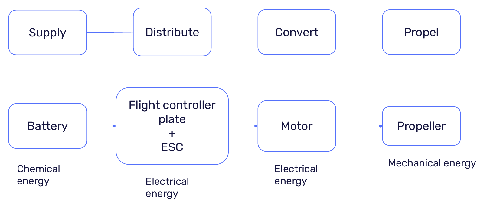
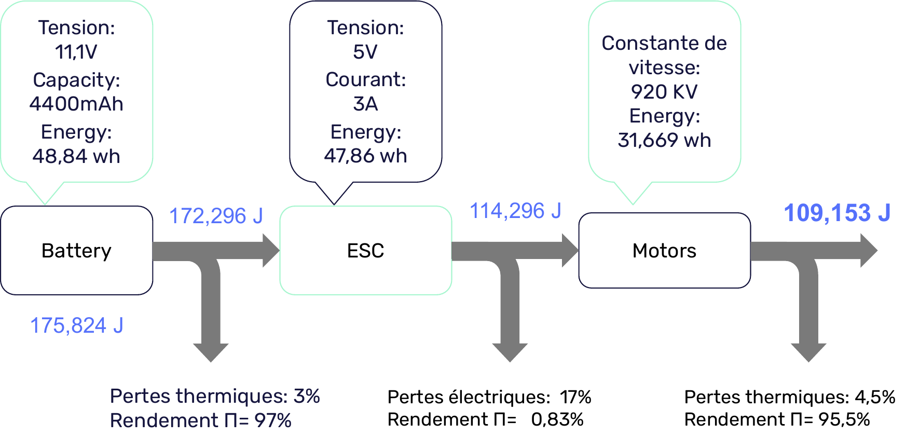
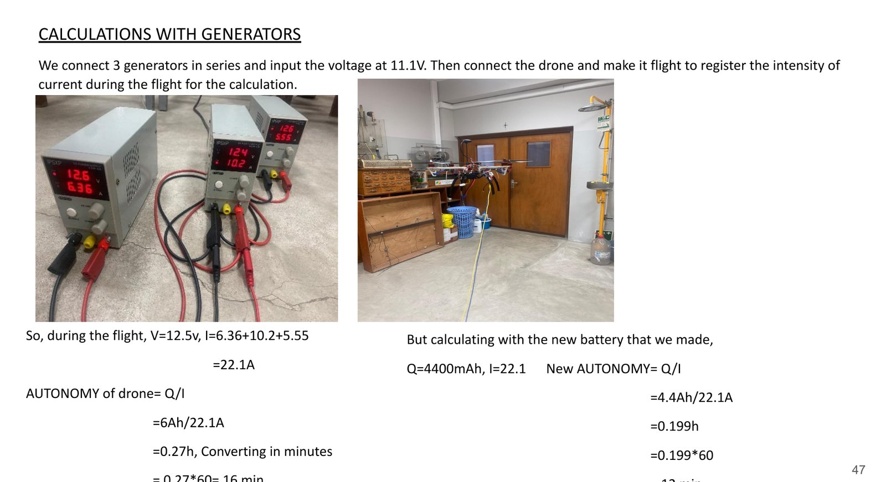

# Énergie et autonomie du drone

*Domaines EEE et EEM.*

## Chaîne de conversion d'énergie

| Bloc | Composant | Forme d'énergie |
|---|---|---|
| Alimenter / stocker | Batterie LiPo 3S 11,1 V | Chimique → électrique |
| Distribuer | Carte de distribution + ESC (variateurs) | Électrique |
| Convertir | Moteurs brushless 920 KV | Électrique → mécanique |
| Transmettre | Hélices | Mécanique (rotation) → poussée |

## Diagramme de Sankey (semestre 1)

Batterie 3S 11,1 V, 4400 mAh, soit 48,84 Wh = 175 824 J.

| Étage | Pertes | Rendement |
|---|---|---|
| Batterie | thermiques 3 % | 97 % |
| ESC | électriques 17 % | 83 % |
| Moteurs | thermiques 4,5 % | 95,5 % |

## Calcul de l'autonomie (semestre 2)

**Estimation théorique** (batterie 6000 mAh, 11,5 V, BEC de l'ESC 3 A) :

- Puissance pour un moteur : P = U × I = 11,5 × 3 = 34,5 W
- Pour les 4 moteurs : P = 4 × 34,5 = 138 W
- Autonomie = Q / I = 6 Ah / 6 A = **1 h** (valeur théorique optimiste)

**Mesure en vol** : alimentation par 3 générateurs en série réglés à 11,1 V, avec relevé du courant pendant le vol.

- U ≈ 12,5 V ; I = 6,36 + 10,2 + 5,55 = **22,1 A**, soit P ≈ 12,5 × 22,1 ≈ 276 W
- Avec la batterie de 6000 mAh : 6 / 22,1 = 0,27 h, soit **≈ 16 min**
- Avec la batterie de 4400 mAh : 4,4 / 22,1 = 0,199 h, soit **≈ 12 min**

La mesure réelle donne une autonomie environ 4 à 5 fois plus courte que l'estimation théorique : le courant consommé en vol est bien plus élevé que le seul courant du BEC.

> Bonnes pratiques batterie : la recharger complètement, ne jamais la décharger complètement. Durée de vie d'environ 300 cycles.
