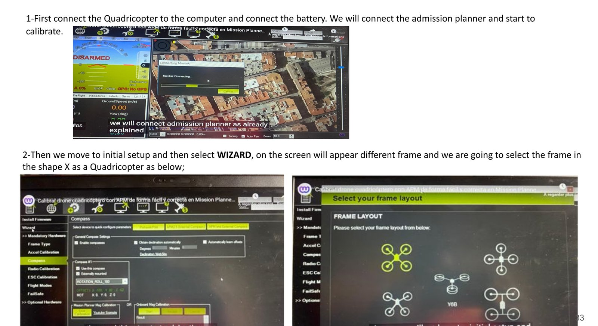
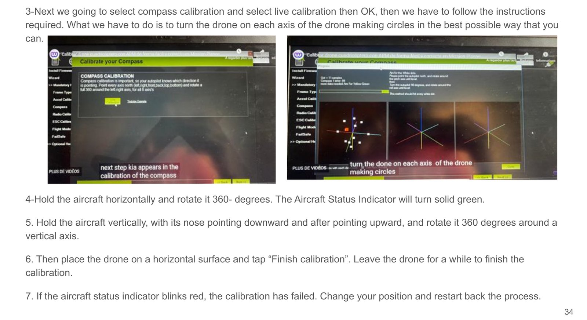
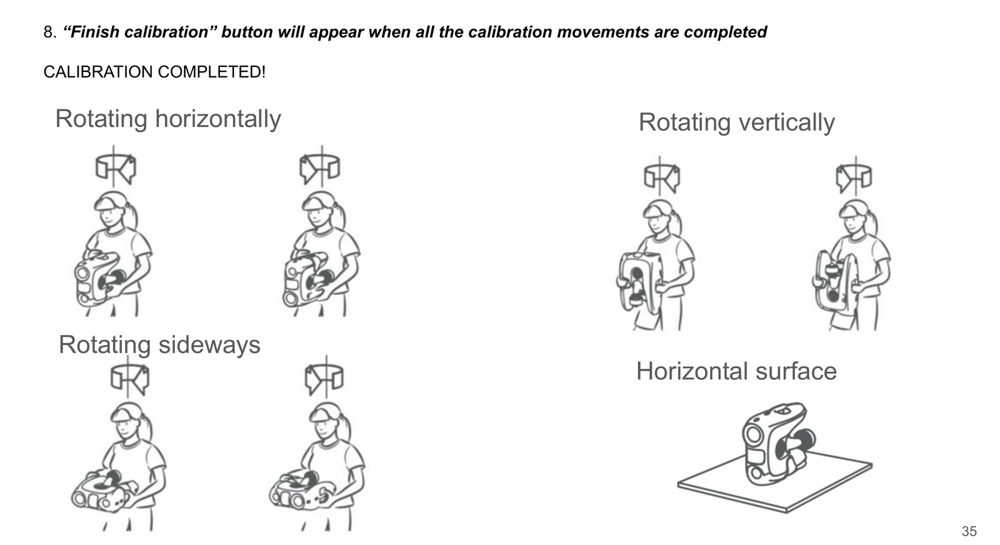
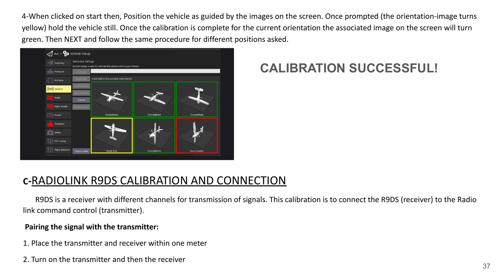
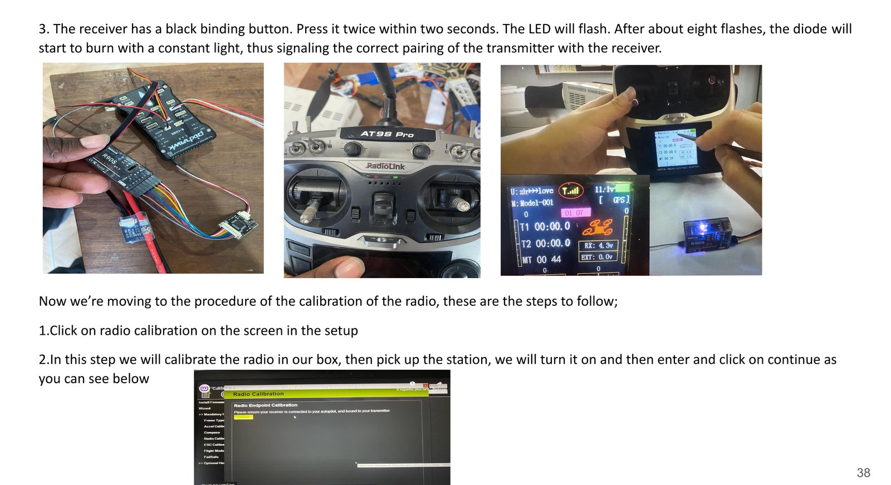
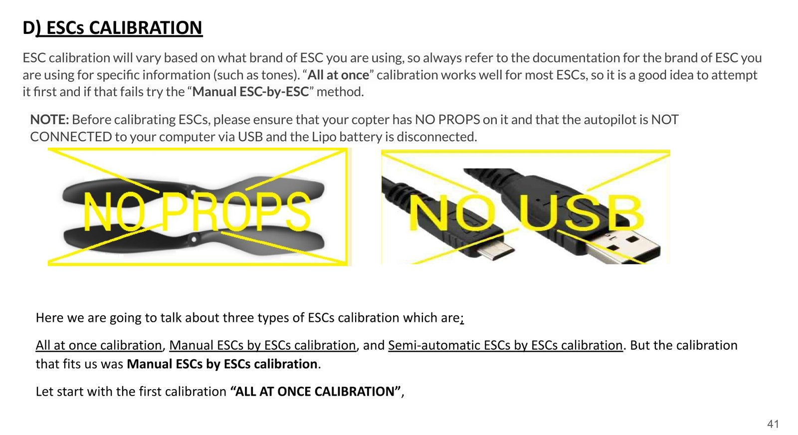

# Calibration des capteurs, de la radio et des ESC

*Domaine EEE, semestre 2. Toutes les calibrations ont été faites avec **Mission Planner** (ArduPilot) sur le contrôleur de vol Pixhawk.*

Rapport complet : [EEE_rapport-semestre-2.pdf](../rapports/EEE_rapport-semestre-2.pdf)

---

## 0. Préparation : choix du châssis

1. Relier le quadricoptère au PC en USB et brancher la batterie, puis se connecter dans Mission Planner.
2. Aller dans *Initial Setup → Wizard* et choisir le châssis **Quad en X**.

## A. Compas (magnétomètre)

Le compas donne l'orientation magnétique du drone, donc son cap en vol.

> ⚠️ Ne pas calibrer près de masses métalliques ou de sources d'interférences magnétiques (parkings, dalles en béton armé, ponts, voitures, échafaudages, antennes relais), ni avec un téléphone en poche. Choisir un espace dégagé.

1. *Compass → Live calibration → OK*.
2. Tenir le drone à l'horizontale et le faire tourner sur 360°.
3. Le tenir verticalement, nez vers le bas puis vers le haut, et le faire tourner sur 360° autour de l'axe vertical.
4. Le faire tourner sur le côté.
5. Le poser sur une surface horizontale et cliquer sur *Finish calibration*.
6. Si l'indicateur clignote en rouge, la calibration a échoué : changer d'endroit et recommencer.

## B. Accéléromètre

Il fixe la référence « à plat » du drone. Une mauvaise calibration rend le vol stationnaire instable.

1. *Accel Calibration → Calibrate Accel*.
2. Placer le drone dans chaque position demandée à l'écran (à plat, côté gauche, côté droit, nez en bas, nez en haut, sur le dos). Quand l'image devient jaune, ne plus bouger le drone ; elle passe au vert une fois la position validée.
3. Passer à la position suivante avec *Next*.

## C. Radiocommande RadioLink AT9S Pro + récepteur R9DS

**Appairage**
1. Placer l'émetteur et le récepteur à moins d'un mètre l'un de l'autre.
2. Allumer l'émetteur, puis le récepteur.
3. Appuyer deux fois en moins de 2 s sur le bouton noir du R9DS. La LED clignote environ 8 fois puis reste allumée : l'appairage est fait.

**Calibration**
1. *Radio Calibration*, allumer la télécommande.
2. Vérifier le sens des voies : stick droit vers le haut → barre *Pitch* vers le bas. Si c'est l'inverse, inverser la voie sur la télécommande.
3. *Calibrate Radio*, puis faire faire des cercles complets à tous les sticks et basculer tous les interrupteurs de mode de vol.
4. Remettre les sticks au centre, puis cliquer sur *Click when done*.
5. Attribuer les modes de vol aux positions de l'interrupteur.

## D. ESC (contrôleurs de vitesse)

> ⚠️ **Hélices démontées**, autopilote **non relié en USB**, batterie LiPo débranchée avant de commencer.

Trois méthodes existent. Celle qui a fonctionné sur notre drone est la **calibration manuelle ESC par ESC**.

**Manuelle, ESC par ESC (retenue)**
1. Brancher le câble 3 fils d'un ESC sur la voie des gaz (*throttle*, en général la voie 3) du récepteur.
2. Allumer l'émetteur, gaz au maximum.
3. Brancher la batterie : une mélodie, puis deux bips.
4. Après les deux bips, mettre les gaz au minimum.
5. L'ESC émet un bip par élément de batterie (3 pour une 3S), puis un bip long : la calibration est faite.
6. Débrancher la batterie et recommencer pour chaque ESC.
7. Si ça ne marche pas : inverser la voie des gaz sur l'émetteur, ou baisser le trim des gaz à 50 %.

**Tous en même temps (*all at once*)** : gaz au maximum, brancher la batterie (LED rouge/bleue/jaune en cycle), débrancher puis rebrancher en gardant les gaz au maximum, appuyer sur le bouton de sécurité jusqu'au rouge fixe, attendre les bips, mettre les gaz au minimum, attendre le bip long.

**Semi-automatique** : paramètre `ESC_CALIBRATION = 3` dans Mission Planner, couper l'alimentation, rebrancher la batterie, appuyer sur le bouton de sécurité, attendre la séquence de bips.

**Test (toujours sans hélices)** : mode *Stabilize*, armer, donner un peu de gaz. Les 4 moteurs doivent démarrer en même temps et tourner à la même vitesse. Sinon, recommencer la calibration. Désarmer.
