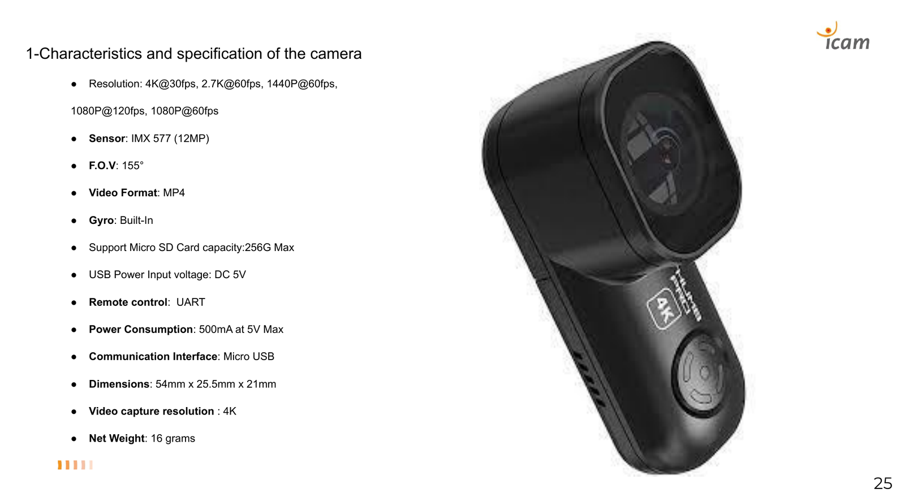
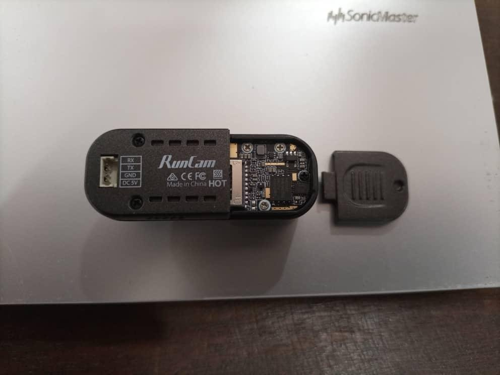
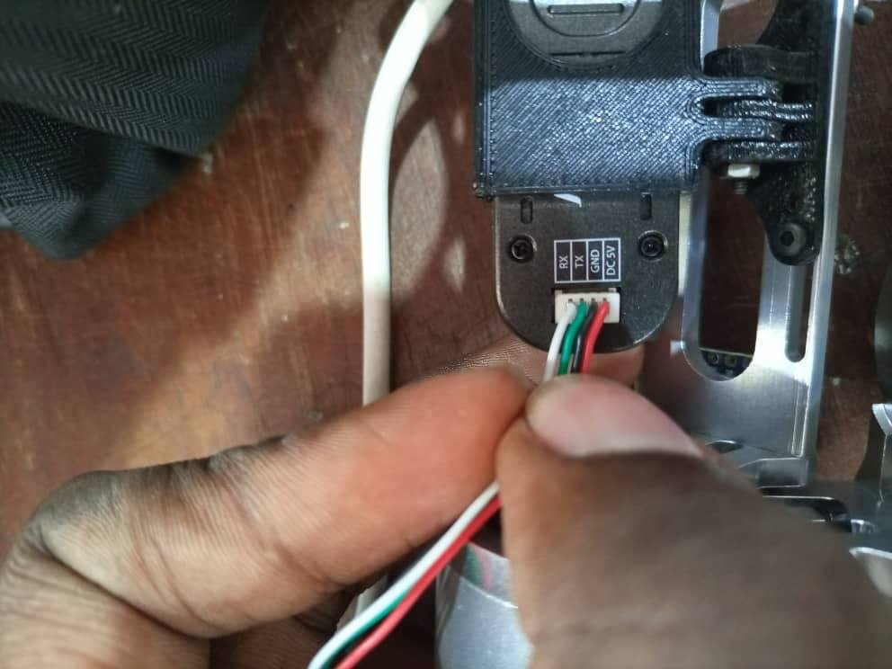
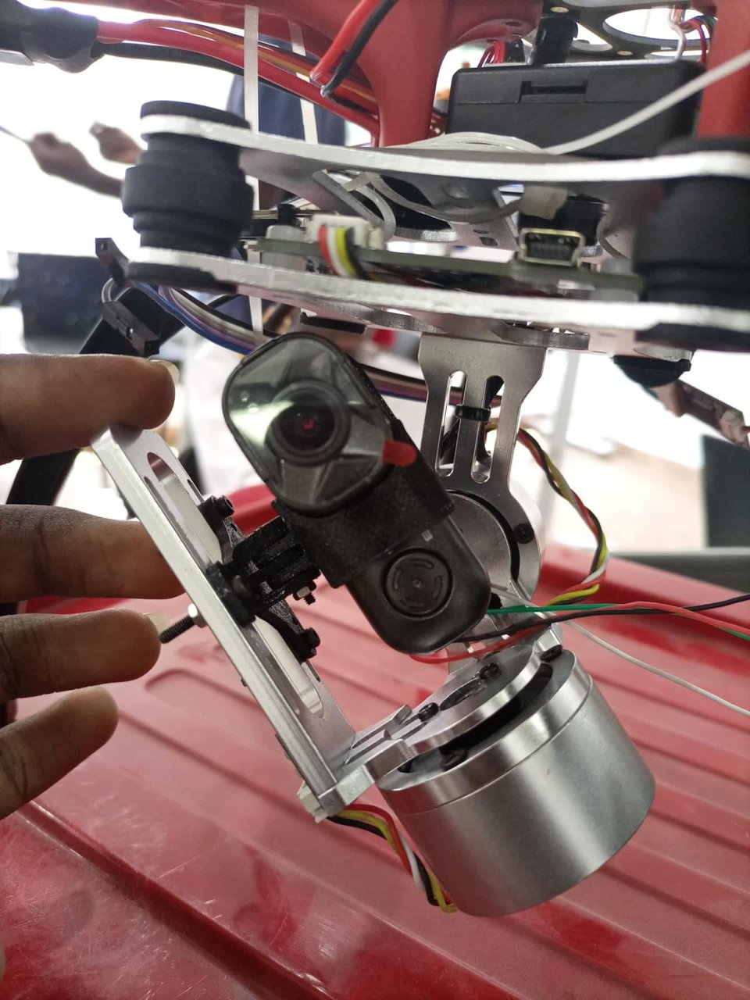
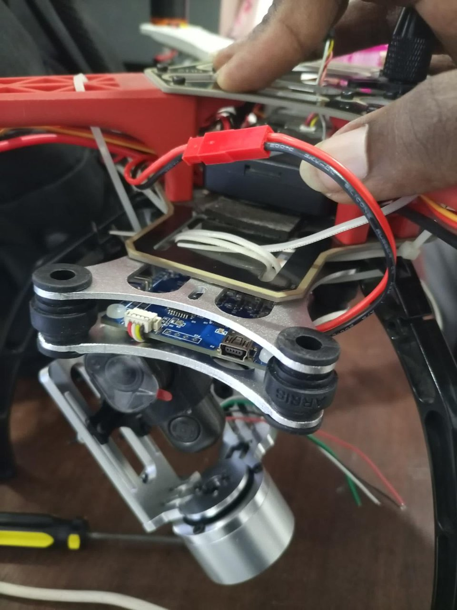
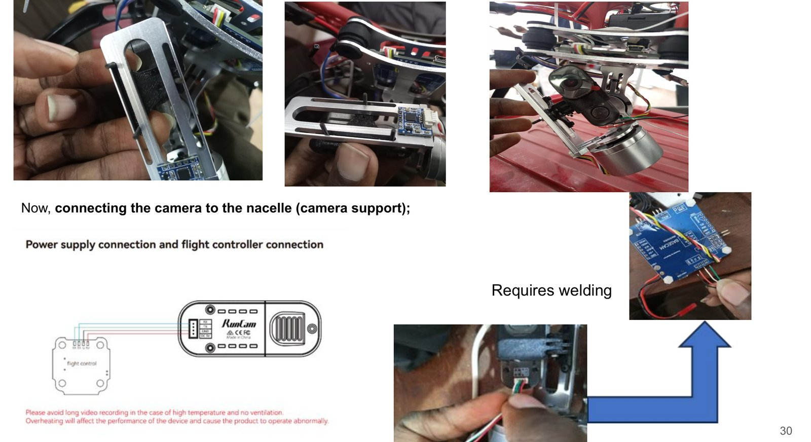
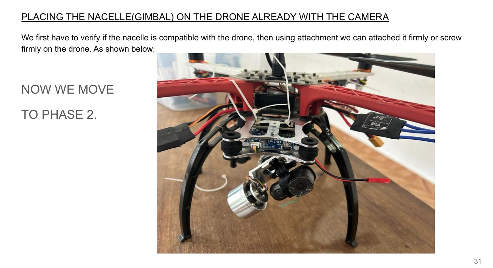

# Intégration de la caméra et de la nacelle

*Domaine EEE, semestre 2 : ajouter une caméra de prise de vue au drone.*

Supports : [EEE_montage-camera.pdf](../rapports/EEE_montage-camera.pdf) · [EEE_rapport-semestre-2.pdf](../rapports/EEE_rapport-semestre-2.pdf)

## Caméra : RunCam Thumb Pro

| Caractéristique | Valeur |
|---|---|
| Résolution | 4K@30fps, 2.7K@60fps, 1440p@60fps, 1080p@120/60fps |
| Capteur | Sony IMX577 (12 MP) |
| Champ de vision | 155° |
| Format vidéo | MP4 |
| Gyroscope | Intégré |
| Carte microSD | 256 Go max |
| Alimentation | 5 V DC, 500 mA max |
| Commande à distance | UART (connecteur 1,25 mm 4 broches vers le contrôleur de vol) |
| Interface | Micro-USB |
| Dimensions / masse | 54 × 25,5 × 21 mm / 16 g |

## Choix de la nacelle (gimbal)

La nacelle stabilise la caméra : des moteurs, pilotés par des capteurs, compensent les vibrations et les inclinaisons du drone.

| Critère | Nacelle motorisée | **Nacelle 2 axes** | Nacelle 3 axes |
|---|---|---|---|
| Tension d'alimentation (V) | 10 – 25 | **7,5 – 11,2** | 12 – 30 |
| Masse (g) | 160 – 500 | **160 – 500** | 210 – 960 |
| Stabilisation | Bonne | **Bonne** | Élevée |
| Flexibilité | Logiciel compatible | **Bonne** | Très bonne |
| Commande | Manuelle | **Auto / manuelle** | Auto / manuelle |
| Coût | 115 – 400 $ | **70 – 100 $** | 95 – 500 $ |

**Choix retenu : la nacelle 2 axes.** Elle stabilise bien pour de la prise de vue aérienne, sa masse convient à un drone de taille moyenne comme le F450, et c'est la moins chère.

## Montage

1. Insérer la carte microSD dans la caméra.
2. Placer la caméra dans son support souple.
3. Fixer l'ensemble sur la nacelle en position d'équilibre et vérifier que la caméra fonctionne.
4. Raccorder la caméra à la nacelle motorisée (**une soudure est nécessaire**).
5. Vérifier que la nacelle est compatible avec le châssis, puis la visser solidement sous le drone.

| | |
|---|---|
|  |  |
|  |  |

